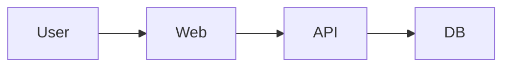

# Canvas — 文字から、伝わる。

会議の画面共有に使う、Markdown＋Mermaidの一枚のエディター。
ツールバーやプレビュー切替なしで、文章と図を編集できます。

## 起動

Node.js 24以上を推奨（依存関係はpackage-lock.jsonで固定）。

```sh
npm ci
npm run dev
```

表示されたlocalhostのURLをChromeで開きます。初回は編集可能なサンプルを表示します。

```sh
npm run check       # 型検証 / Lint / Vitest / 本番ビルド
npx playwright install chromium
npm run test:e2e    # ブラウザ回帰テスト
npm run preview    # 本番ビルドのローカル確認
PRODUCTION_TEST=1 MEASURE=1 npm run test:e2e  # build後、4173ポートを空けて実行
```

macOSではインストール済みGoogle Chrome、CIではPlaywright Chromiumを使用します。
ブラウザ未導入の別環境は `PLAYWRIGHT_CHROMIUM=1 npm run test:e2e` でPlaywright Chromiumを使用できます。

## 操作

| 操作 | 方法 |
|---|---|
| 文章を書く | そのまま入力。`#`見出し、`**太字**`、リスト、コードに対応 |
| 図を描く | `mermaid`のコードフェンスを入力、または操作一覧から「図を追加する」 |
| 図を編集 | 図をクリック、または矢印キーでソース位置へ移動 |
| 図の編集を終える | `Esc`で図の後へ |
| 操作一覧 | `Cmd/Ctrl + Shift + P` |
| ヘルプ | `F1` |
| Undo / Redo | `Cmd/Ctrl + Z` / `Cmd/Ctrl + Shift + Z` |
| 入出力・AI | 操作一覧から。AI修復は図を選んでから実行 |

図の例：

````markdown
# システム構成

説明文と図を混ぜて書けます。



図の下に説明を続けます。
````

## 保存とプライバシー

- 文書はこのブラウザのIndexedDBへ自動保存します。サーバー保存・共同編集・同期はありません。
- ブラウザのサイトデータ削除で失われます。大切な内容は操作一覧から `.md` に書き出してください。
- 保存は約250ms後。直後の強制終了は未保存の可能性があります。保存失敗は画面下に通知します。
- インポートは現在の文書を置き換えます。Undoで復帰できます。改行はLFに統一します。
- Markdown原文を保持し、不正な図や未対応のMarkdown記法も保存・書き出します。
- 基本編集・描画・AI推論で文書内容を外部へ送信しません。分析SDKはありません。
- アプリ配信時のホスティングアクセスログはアプリ独自のテレメトリーとは別です。GitHub Pagesはセキュリティ目的でIPアドレスを記録します。
- 同じサイトを複数タブで編集すると、最後に保存したタブの内容が残ります。PoCでは一つのタブで使用してください。

## 端末内AI

Chrome Built-in AIのPrompt APIを使います。クラウドAPIキーやサーバーは不要です。
**AIを開くまでモデルを初期化せず、ダウンロードも開始しません。**

対応Chrome、対応OS、十分なメモリ・ストレージが必要です。日本語・英語を指定して実際のAPIで可否を確認します。
初回モデル導入にはChromeプロファイルのボリュームに22GB以上の空き容量が必要です。
初回ダウンロードは通信しますが、推論は端末内です。非対応環境でも基本編集は使えます。

[最新の対応条件（Chrome公式）](https://developer.chrome.com/docs/ai/prompt-api)

生成・修復は構文検証と試験描画を通過した候補だけを表示し、承認後に反映します。
AIは内容を間違える可能性があります。図とコードを確認してください。修復時は差分も表示します。
処理中の編集、取消、対象図の変更・削除を扱い、古い候補による上書きを防ぎます。

**モデル応答を差し替えた自動テストは、実モデルによる成功証明ではありません。** 実際の検証状態は [検証記録](docs/VERIFICATION.md) を参照してください。

## PoCの範囲

正式な描画検証対象はFlowchartとSequence Diagram。Mermaidの他形式は利用できる場合がありますが保証範囲外です。
図は30,000文字・300エッジまで。図内設定変更、外部画像、生HTML実行は無効です。
大きい図は文字を潰して縮小せず、図内を横スクロールします。

Chrome拡張、複数文書管理、共同編集、クラウド保存、認証、課金、独自モデルは実装しません。
日本語IMEのネイティブ実機確認、実モデルAIの確認状況と既知の問題は [CURRENT.md](CURRENT.md) を参照してください。

## 公開と再開

GitHub Actionsが検証後、Viteの静的ビルドをGitHub Pagesへ公開します。
`BASE_PATH=/<リポジトリ名>/ npm run build` で公開用パスを設定できます。

- [構成・判断](ARCHITECTURE.md)
- [進捗と残課題](CURRENT.md)
- [検証記録](docs/VERIFICATION.md)
- [実装計画](docs/superpowers/plans/2026-11-05-canvas.md)

公開リポジトリですが、現時点ではライセンスを付与していません。Webアプリは無料で利用できます。OSSとしての再配布ライセンス選定は別途行います。
